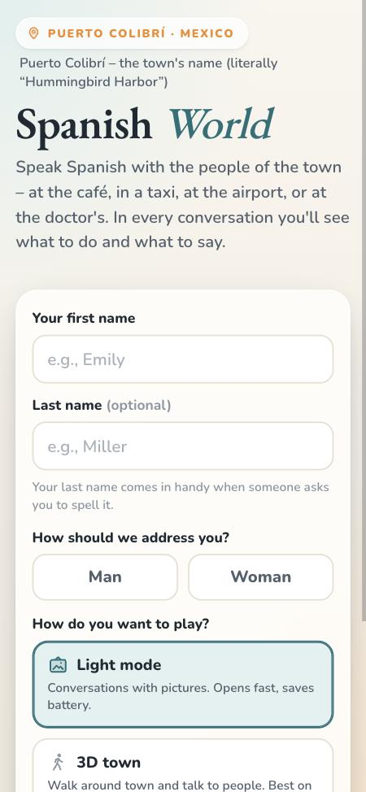
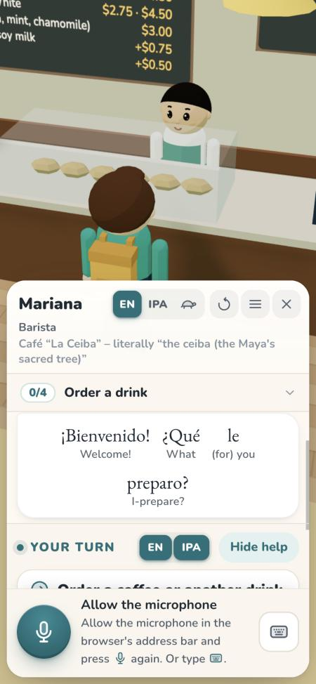
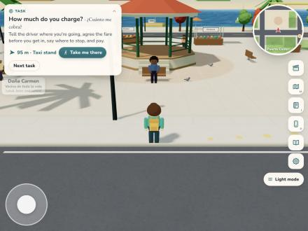
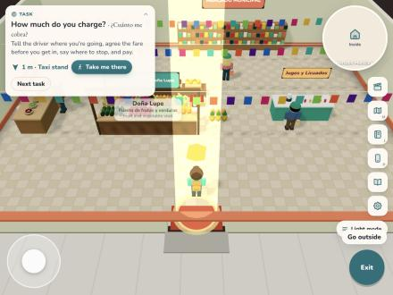

# Puerto Colibrí: the first stretch (1 Nov 2026)

Branch `spanish-edition` on GitHub (english-world). Nothing is live; Maple Harbor is unchanged.

## What's done

- **One engine, two editions.** A Spanish build sees `src/editions/es/…` instead of the base file with the same path
  (docs/es/EDITIONS.md). The engine's English word lists moved into one language module with their values unchanged.
  The Spanish one has Spanish negation ("No quiero leche" is never "No" + an order), tú/usted and gender slips,
  spellings by sound, numbers, pesos ("ochenta y cinco cincuenta", "15 mil", "veinte pesos de limón"), times
  ("cuarto para las ocho"), Spanish letter names and phone numbers in pairs.
- **The owner's decisions:** Puerto Colibrí; Mexican Spanish with a Settings switch to neutral Latin American (lines with
  a Mexican-only word have a neutral twin); learners' Spain forms count as correct (vosotros, zumo, móvil, coche, vale);
  a Mexican cast; English help.
- **Three model conversations, fully Spanish:** the café (Mariana, Café La Ceiba), the mercado (Doña Lupe's stall:
  kilos, "¿a cómo?", "¿para hoy o para mañana?", the pilón) and the taxi (Don Rigo: the fare agreed before you get in).
  Café 93/93 understanding tests, mercado 49/49, taxi 44/44; every conversation completes on 12/12 seeds; no crashes.
- **The interface in English** for the Spanish edition: 494 strings through `L()`. In the English edition the rendered
  pages were compared in 144 states: identical.
- **The zócalo and the mercado restyled:** a kiosco instead of the fountain, papel picado, palms, Mexican colours,
  Spanish signs, and the market hall's stalls inside.
- **The plan** for the executor: docs/es/ (style sheet, authoring guide, 47 briefs, town tasks, acceptance gate,
  review loop, the trial prompt).

## Checks

- Both editions' tests: 257 pass (202 English, 55 Spanish). TypeScript clean.
- The English edition's behaviour: a fingerprint of every test reading, every sim's transcript on 12 seeds, the
  corpus and blind sets and every sentence the game can speak was **identical** after the engine move.
- The English build contains no Spanish content strings (the Spanish modules are never imported there).
- Draw calls at phone size: the zócalo 177–193, the market hall 49 (Maple Harbor's square was about 170 in October).

## Pictures

| | |
|---|---|
|  |  |
| The title, in English, at phone size | The café: Spanish with English glosses |
|  |  |
| The zócalo's kiosco, stalls and the sea | Doña Lupe's stall in the Mercado Municipal |

## Next

1. The trial: the executor writes s68-hotel from docs/es/HANDOFF-SOL.md; the lead reviews it and adjusts the plan.
2. The open questions in docs/es/PLAN.md (the restaurant, the church, the salon's register, the course map, voices).
3. Small follow-ups: the room signs inside (the café's menu board is still in dollars), the IPA button (no Spanish IPA
   yet), the title page's picture deck (Maple Harbor's is hidden in Spanish until the new pictures come).
