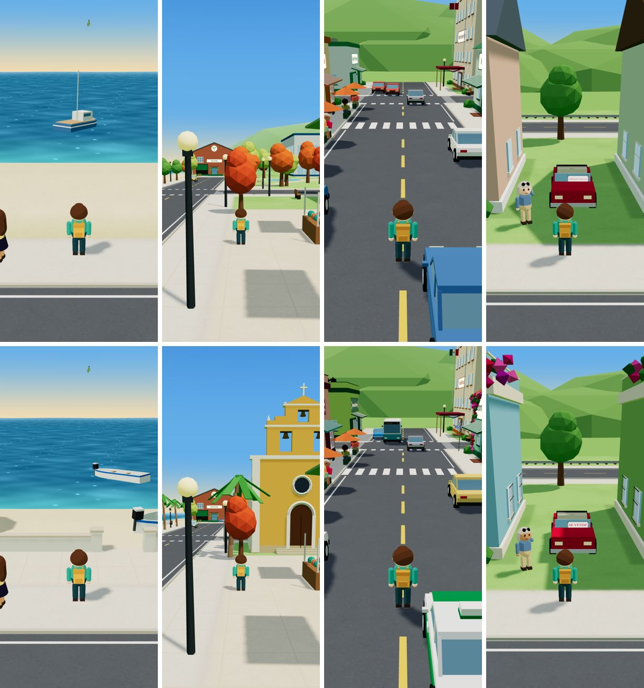
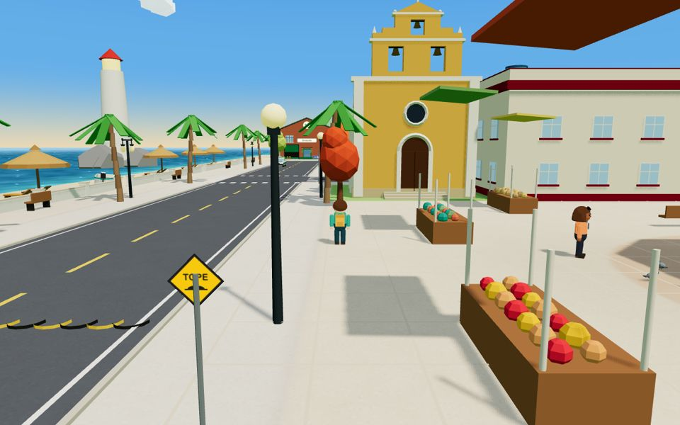
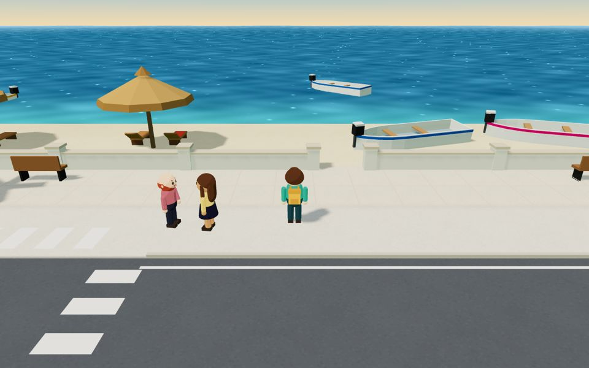
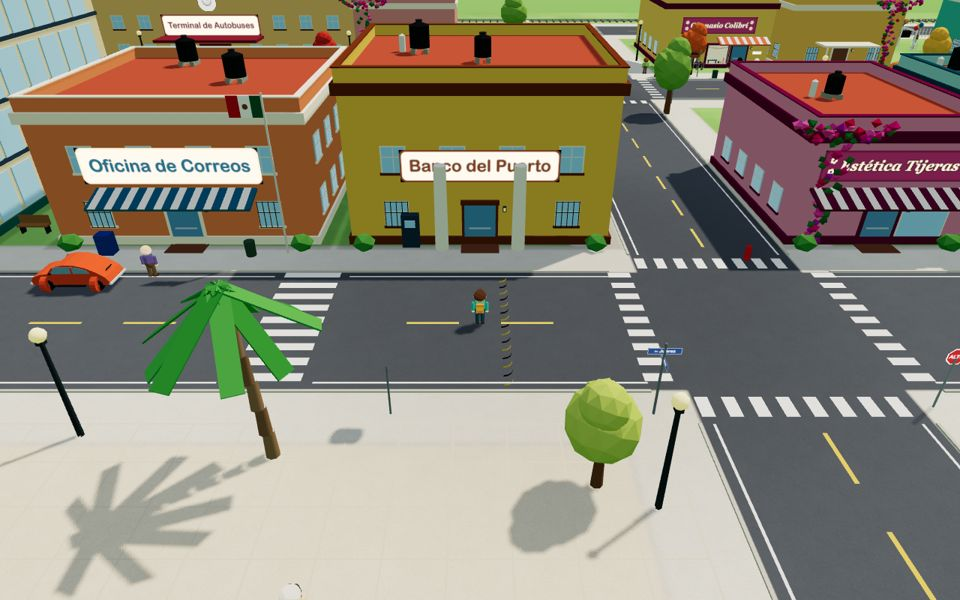
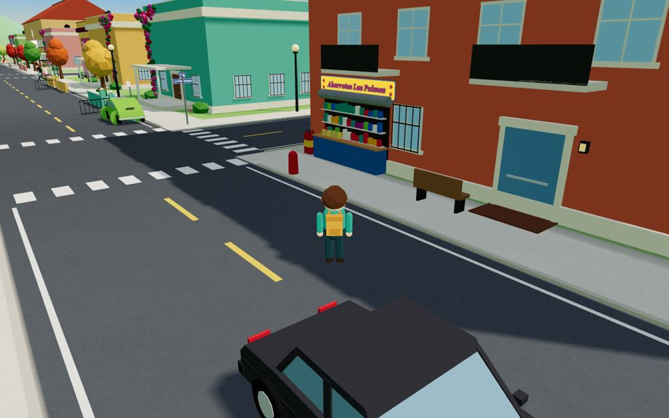
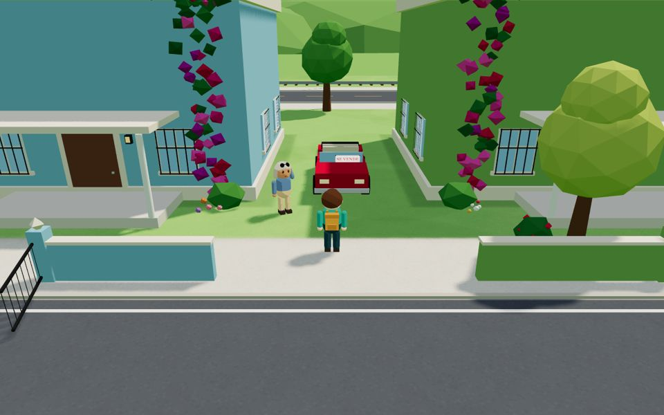

# Puerto Colibrí's look: how the town is restyled

Maple Harbor's 3D town (src/game/world/) becomes Puerto Colibrí's in the Spanish edition, area by area. The rule is
the one for the whole edition: **one engine, never a copy**. The town builder stays shared; the Spanish edition
switches looks on through its theme, `src/editions/es/game/world/theme.ts` (the base `src/game/world/theme.ts` has
every switch off, so Maple Harbor is built exactly as before).

## Done: the zócalo and the mercado (the model area)

- **The kiosco** replaces the fountain in the middle of the square (`addKiosco` in town.ts): an octagonal stone
  platform with steps on the south side, green iron columns and railing, a red tiled cupola with a lantern. The
  pigeons peck round it; Rosa's bench, the chatting pair and Lucy keep their places.
- **Papel picado** from the kiosco's eaves to eight points round the square (`makePapelPicado`): cut-paper flags
  with holes, in one mesh, swaying a little.
- **Palms** at the square's corners and edges (`makePalms`): one instanced mesh with swaying crowns; a palm whose
  spot is taken by another solid thing is left out.
- **The stalls' signs** in Spanish (Flores, Frutas, Verduras, Pan dulce); the small white gazebo is gone.
- **Colours**: the buildings round the square and along the main street painted as in a Mexican Caribbean town
  (theme `buildings`); every sign carries the Spanish place name (theme `locationSigns`).
- **The Mercado Municipal inside** (`mercado()` in interiors.ts): Doña Lupe's fruit and vegetable stall where the
  supermarket's checkout is (her spot and the learner's are the same), produce, a scale, bananas on a beam, a chili
  and spice stall, a juice stand, groceries at the back, papel picado under the roof; the shoppers stand at the
  stalls (roomPeople.ts).
- **Draw calls** (phone size, the camera on the square; `game.renderer.info.render.calls`): see docs/es/REPORT.md.

## Done: the outdoor town (4 Nov 2026, tasks 1–5, the vehicles and the sounds)

All of it is switched on by theme fields (src/game/world/theme.ts documents each one; Maple Harbor's values switch
everything off) and built by `src/game/world/mexican.ts` (new shapes) and a few theme checks in town.ts, car.ts,
ambient.ts, audio.ts and Game.ts. The solid pieces are merged into two vertex-coloured meshes (`town-mx`, which casts
shadows, and `town-mx-small`, which doesn't) and every new sign is a cell of one texture (`SignAtlas`, one mesh): the
whole restyle adds three meshes (four draw calls, with `town-mx`'s shadow) and takes away more than that (the roof
kits, a yacht, the chimneys, the mailboxes, the beach umbrellas' towels, the stop signs' octagons, the flags).

- **Task 1, the malecón and the beach** (`malecon`, `palapas`, `lanchas`): paving with its joints from Harbor Road's
  sidewalk to a low white wall with a stone cap and pillars, open where steps would go down to the sand (about every 24
  m) and where the pier's boardwalk crosses; benches facing the sea; the lamp posts along the beach carry two lanterns
  on an arm; palms instead of the street trees along the beach (the trees keep their random numbers, unseen); a "Tours a
  los cenotes" kiosk (a teal hut with a thatched roof and its painted sign) by the pier; a "Malecón" tile plaque; twelve
  palapas with two wooden loungers each instead of the four umbrellas; lanchas (white, a coloured stripe, an outboard)
  afloat by the pier and three pulled up on the sand instead of the yachts; Restaurante El Muelle under a palapa roof
  (BuildingLook `roof: "palapa"`).
- **Task 2, the main street's shops** (`buildings`, `mexican`, `parkedCars`): the car rental, the gas station, the
  clinic, the gym, the apartments, the bus terminal and El Muelle in Mexican colours (the trims and awnings reuse
  colours the square already has: each new one is a draw call everywhere in town); every flat roof painted red with a
  parapet and one to three tinacos (black water tanks; sometimes a white gas tank) instead of the vents, hatch, air
  conditioner and water tank on legs (the airport and the office tower keep theirs); iron bars on the ground floor's
  front windows (all round on the houses); the shops' and restaurants' signs painted by hand (a coloured board, outlined
  italic letters, little painted flowers); pale-trimmed buildings' printed signs in a dark ink (Correos was cream on
  cream); the hotel's and the post office's flags Mexican; the parked cars five vochitos and five small sedans in
  Mexican colours.
- **Task 3, the church** (`church`): a parroquia at the square's east end beside the Policía Municipal, facing the
  kiosco across the square: an ochre nave under a white barrel vault with buttresses and small arched windows, a facade
  with pilasters, an arched wooden door at the top of three steps and a round window, and an espadaña with three bells
  in two tiers and a cross. The bench that stood there is gone. Built there because the north side has no room
  without moving the stalls and Lucy (PLAN.md open question 2): if the owner prefers the north side, it is the
  theme's `church` (where its door is, which way it faces) plus moving the stalls.
- **Task 4, the street furniture** (`streetSigns`, `stopWord`, `taxi`, `busSign`, `topes`, `foodCart`, `townSigns`):
  blue street name blades at eight corners (see the town facts); ALTO on the stop signs; a "SITIO DE TAXIS" sign and a
  white-and-green taxi at the stand; "PARADA" at the bus stop; three topes (yellow and black) with their TOPE warning
  signs, two across Juárez at the square's ends and one across del Puerto; an elote cart (a tricycle with a steaming
  pot, a striped parasol and its painted sign, "Elotes · Esquites") on the square by Juárez; the outdoor posters and
  notices in Spanish (the museum's banners "Colores de la noche", the mercado's, the clinic's, the gym's hours from
  s35, "SE VENDE" on the convertible, "Fiesta → al patio").
- **Task 5, the residential streets** (`buildings`, `mexican`, `bougainvillea`, `tiendita`): the five houses in bright
  colours with flat roofs, parapets and tinacos, a low wall (barda) with an iron gate standing open instead of the
  picket fence, a potted plant where the mailbox stood (the same colliders), no chimneys; bougainvillea climbing beside
  the door and spilling along the top of the wall on the houses and on four buildings of the square and the main
  street (Café La Ceiba, La Cocina de Lucía, Información Turística, Estética Tijeras); "Abarrotes Las Palmas", a
  tiendita in the ground floor of Departamentos Las Palmas at its corner (s81, s82: "hay una tiendita en la esquina"):
  shelves of goods, a counter, the shutter rolled up, crates of bottles, its painted sign, and a painted sign on the
  side wall ("Refrescos · Botanas · Recargas"); no brand anywhere.
- **The vehicles** (`traffic`, car.ts): among the passing cars, the city bus of route 7 (s67b: white over turquoise, the
  7 lit in amber over the windshield; 9.6 m long, so the traffic's gaps and the player's collision follow each
  vehicle's length), a colectivo (a white van with a stripe and its route board) and two white-and-green taxis.
- **The sounds** (`sounds`, audio.ts `townSounds`): made on the spot like the gulls, no recordings: the church bell
  (three to six strokes every one and a half to two and a half minutes, louder near the church), the street vendors
  round the square (the knife grinder's pan pipe, the ice-cream cart's bells, the camote cart's steam whistle) and in
  the streets of houses the gas truck going by with its tune (a jingle of our own) or the garbage truck's hand bell
  (s82).
- **Cost** (`renderer.info.render`, the same 14 views at the same moments in both editions, quality "high"): the draw
  calls are 2–9% fewer than Maple Harbor's at every view but one (the church seen across the square on a phone, +3%);
  the triangles are 11–26% more (24 to 45 thousand: mostly `town-mx` drawn again in the shadow pass, the bougainvillea
  and the palms; the window bars are flat strips, the roof parapets and tinacos cast no shadow). Draw calls per view,
  Maple Harbor → Puerto Colibrí:

  | View | Desktop (1280×800) | Phone (375×812) |
  |---|---|---|
  | the zócalo from avenida Juárez | 200 → 187 | 168 → 159 |
  | the church across the square | 227 → 220 | 156 → 161 |
  | Juárez and Ceiba, east | 310 → 298 | 240 → 227 |
  | avenida Juárez, west | 227 → 209 | 212 → 195 |
  | Juárez and Itzamná, east | 215 → 202 | 179 → 168 |
  | the malecón and the beach | 131 → 126 | 131 → 128 |
  | along the malecón, west | 167 → 154 | 139 → 132 |
  | El Muelle | 145 → 137 | 144 → 136 |
  | the palapas | 117 → 108 | 101 → 94 |
  | the taxi stand | 169 → 163 | 154 → 151 |
  | the tiendita, calle Hidalgo | 214 → 207 | 155 → 144 |
  | Casa de Diego y Natalia | 182 → 168 | 165 → 150 |
  | calle Hidalgo, east | 235 → 218 | 179 → 166 |
  | Calle de los Cedros | 145 → 133 | 139 → 128 |

- **Maple Harbor unchanged**: the same 28 views of the English edition rendered before the change (from a copy of the
  base commit) and after it: pixel-identical (time and Math.random driven by hand, GPU rendering; a run now and then
  differs from any other by ±1 in one colour channel at a few scattered pixels, the same with unchanged code, so a
  check is repeated); a hash of the whole built town (all 1,085 objects' geometry, materials, transforms and canvas
  pixels, the colliders, seats and doors): identical; the English fingerprint (tools/fingerprint.ts): identical.
  Every switch is off in Maple Harbor and no new random number is drawn from the town's stream (the roof boxes'
  draws now happen only on roofs that are flat in layout.ts, which is where they always happened).
- **Pictures**: Maple Harbor above, Puerto Colibrí below, at phone size (the malecón, the church, avenida Juárez with
  route 7's bus, Calle de los Cedros):

  

  | | |
  |---|---|
  |  |  |
  | The parroquia across the zócalo, a TOPE on avenida del Puerto | The malecón, a palapa, lanchas on the sand |
  |  |  |
  | Red roofs, tinacos, painted signs, a Mexican flag | Abarrotes Las Palmas, a vochito, a street sign |
  |  | |
  | Calle de los Cedros: bardas, iron gates, bougainvillea | |

### What's left outdoors

- **The church's place** is the owner's to confirm (PLAN.md open question 2); moving it is the theme's `church` and,
  for the north side, the stalls.
- **The sounds** are made on the spot, like Maple Harbor's gulls and birds: recordings (a real church bell, a gas
  truck's jingle, vendors calling "¡Elotes!") would sound better, and would need the owner's files.
- Small things still as in Maple Harbor: the supermarket's shopping carts in front of the Mercado Municipal, the
  US-style blue mailbox at Correos, Ximena's white picket fence and string lights in the backyard (s63), the park's
  autumn-coloured trees (they can pass for flamboyanes and guayacanes), Station Road without a name.
- **Task 8, the cenote and the ruins**, is not started.

## Town facts from the conversations

The conversations name places and say where they are; the 3D town must agree (and so must new conversations).

- **Calle Ceiba** runs along the zócalo. From the visitor center: right, two blocks to the bank (corner of Juárez and
  Ceiba), left into calle Ceiba (s62). On it, facing the zócalo: **Café La Ceiba** ("aquí en la plaza", s69) on the
  right, **Correos** opposite it, then the **mercado** after Correos; the bus **terminal** at the end of the street
  (s62). A cocina económica on calle Ceiba serves comida corrida (s69, s88).
- **The zócalo**: the kiosco (where a boy finds the wallet, s91a), Doña Mari's flower stall and the Saturday
  tianguis (s91a), the church (STYLE.md). The **Policía Municipal** is across the square, next to the **museum**
  (s62, s91a, s91b); the museum is open 10 to 5, closed on Mondays (s62, s69, s70).
- **Farmacia del Puerto** sits between the estética (s62) and the doctor's consultorio next door (s75).
- **The gas station**: the conversation happens outside at the pump, not in the shop (s71b; `locations.ts` still says
  interior).
- **La Cocina de Lucía** (s73), a Yucatecan restaurant: left out of the visitor center, one block, red awning, across
  from Boutique Hilos (s62). It is the Maple Harbor trattoria's building (location id `trattoria`); there is no
  Italian restaurant in town.
- **The arrivals hall**: Itzel's baggage desk, then customs with Agente Medina (`aduana`, a Spanish-only character on
  Officer Diaz's base) and the sniffer dog (s65b).
- **The airport**: flight 223 to Mexico City, check-in → security → sala 4 (boarding 7:30, departure 8:10) (s64a–c).
- **City bus route 7**: centro (zócalo), mercado, clínica, malecón / muelle, Hotel Mar Azul, the beach; $12 (s67b).
- **The streets' names** (on the signs since 4 Nov): **avenida Juárez** is Main Street (s62: the visitor center is on
  it), **calle Ceiba** Center Street (along the zócalo's west side; the bank is on its corner with Juárez; the bus stop
  on calle Hidalgo near it is "Parada · Calle Ceiba"), **avenida del Puerto** Harbor Road (the malecón runs along it),
  **calle Itzamná** East Street (from the zócalo's east end down to the sea, s62), **calle Flamboyán** West Street (by
  Departamentos Las Palmas: "un departamento en la calle Flamboyán", s65a) and **calle Hidalgo** Oak Avenue
  ("calle Flamboyán 23, entre Hidalgo y Juárez", s65b). Station Road has no name yet; calle Morelos (s76's dentist,
  "a una cuadra del zócalo") is not on the map.
- **The tiendita** is in the ground floor of Departamentos Las Palmas, on its corner with calle Flamboyán.

## How a restyling task is done

1. Read `src/game/world/layout.ts` (where everything is), `town.ts` (how the outdoors is built) or `interiors.ts`
   (the rooms), and the zócalo work above (search for `THEME` in those files).
2. Decide what is **data** (a colour, a sign, a list of positions: add a field to `TownTheme` in
   `src/game/world/theme.ts` with Maple Harbor's value as the default, and set Puerto Colibrí's in the Spanish theme)
   and what is **a new shape** (a new builder function in town.ts or interiors.ts, called only when the theme asks).
3. **Maple Harbor must not change**: the default theme switches your work off; new random draws come from a
   `rand(<new seed>)` of their own, never from `r()` (that would move every tree and stall after it).
4. Colliders: everything solid gets one (`col.addBox` / `col.addCircle`), and never on an NPC's spot, a talk spot
   (ax/az in layout.ts and interiors.ts), a door or a path between them.
5. Draw calls: put small things in one mesh (vertex colours: `colourMerge`, interiors' `smalls()`), reuse
   materials (`mat()` caches by colour; `Merger` merges by name). The town on a phone was 153–281 draw calls in
   Maple Harbor (docs/maple-harbor-master-plan "Phone performance"); a restyled area may add **at most 10%** at
   any camera spot in it. Texture-heavy things (signs) cost one draw call each: few.
6. Check it (docs/es/PLAN.md "Acceptance": the town checks), at desktop size and at phone size (375×812), with
   screenshots for the review.

## Done: the rooms and every conversation's spot (tasks 6 and 7; 4 Nov 2026)

Every Spanish word and addition in the rooms is switched on by the Spanish theme (`signs`, `boards`, `restaurant`,
`roomExtras`, `outdoorNpcs`, `spotCars` in `src/game/world/theme.ts`: all empty or off in Maple Harbor's), so the
English rooms are built exactly as before; their views were compared pixel by pixel (below).

- **Every room's signs and posters in Spanish** (task 7): the texts of interiors.ts's `sign()` and `textTexture()` and
  the words drawn on its posters go through `THEME.signs` (an English text → its Spanish), the menus and the bus
  terminal's departures board through `THEME.boards` (by the English board's title). The words follow the
  conversations: Café La Ceiba's board has s72's drinks, pan dulce and peso prices and Mariana's Wi-Fi password; the
  terminal's board s67a's morning buses and andenes and the 5:15 bus; the bank's windows are "Ventanilla 1 · 2 · 3";
  the post office does "Paquetería · Timbres"; the pharmacy "Surtimos recetas", "Recetas" and "Caja"; the apartments
  are on the "primer piso" (s81: one flight up); Hilos has "¡OFERTAS! HASTA 30%" (s74: 20 or 30% off); the police
  board's papers, the clinic's poster, the gym's walls and the office's (Elena's door, p28b) in Spanish too.
- **The airport** (task 6): Spanish over English on two-line signs ("Migración · Mexicanos | Extranjeros /
  Immigration…", "Reclamo de equipaje · Vuelo PC 482 / Baggage claim…", "Servicio de equipaje", "Documentación /
  Check-in", "Filtro de seguridad / Security", "Sala 4 · Vuelo 223 a Ciudad de México / Gate 4…", "← Llegadas ·
  Salidas →"), Mexico's flag on two stands by immigration, and **customs** after the baggage desk: Agente Medina
  (`aduana`) at her lectern facing the desk, her beagle in a green vest sitting beside her, and on the way out the two
  lanes under one board, "Nada que declarar / Nothing to declare" and "Auto declaración / Self-declaration". **No
  red-and-green light**, unlike this task's first wording: s65b's officer says "Aquí ya no hay semáforo" (Cancún's
  model since 2024; docs/es/reviews/s65b-baggage.md). s65b now lists `npcs: ["aduana"]`, so its camera frames her
  with Itzel and the learner; the lanes stand south of that camera, and the lamp over the way to the desk hangs 3 m
  further west (it hung in the picture). The carousel's suitcases are drawn in the customs mesh, which pays for her
  draw calls.
- **La Cocina de Lucía** (s73): `restaurant: "yucateco"` builds a Yucatecan restaurant in the trattoria's room
  (`cocina()` in interiors.ts): ochre walls and a terracotta floor, the trattoria's tables (the diners sit where they
  sat) with bright cloths, salsas and tortilla baskets, Lucía's stand and Luis's spot as before, jars of aguas frescas
  where the wine was, a hammock, talavera plates, papel picado along the side walls (across the room it hid the signs
  from the camera), a picture of Chichén Itzá, s73's dishes, desserts and drinks with their prices.
- **Doña Chela at the pump** (s71b): `gas-station` is an outdoor place in the Spanish locations.ts; the theme puts
  `dot` beside pump 2 at the learner's car (a parked car facing the street), and the learner talks to her from behind
  the car. A character the theme places outdoors is left out of her room (interiors.ts `room()`); the shop has its own
  cashier (roomPeople.ts), "Tienda El Faro".
- **The other places the conversations name**: the pharmacy's door to the consultorio next door, "Consultorio médico
  → · Consulta sin cita" (s75); the bank's turn machine "Turnos", the display "TURNO A-27 · VENTANILLA 2" and the
  dollar's rate, $17.20 / $18.10 (s78); stairs up along the museum's east wall to the new exhibition, "Colores de la
  noche ↑ · planta alta" (s70: upstairs, on the right), the partition's sign now "Colección permanente"; cochinita
  pibil, tortillas, habanero salsa and agua de jamaica on Diego and Natalia's table and Michi the cat on the sofa (s85);
  the white guayabera on a mannequin by Hilos' door (s74); Mexico's flag at the police front desk (s91b).
- **Draw calls** (1280×800, the views of `tools/es-tour.mjs --mode=rooms`, Spanish before → after): the bank's door
  view 39 → 42 (+8%), the museum 61 → 64, the pharmacy 43 → 44, Diego's house 41 → 42, the airport 66 → 65 with Agente
  Medina, the police 30 → 29; La Cocina de Lucía 30 (the trattoria 49); every other room unchanged. The gas pump's
  talk spot outdoors: 154.
- **Maple Harbor unchanged**: the 72 frozen views (23 rooms from the door and at every person's talk spot, the 8
  outdoor talk spots) are pixel-identical before and after, with the same draw calls; `tools/fingerprint.ts` identical.

### Every conversation's spot

`tools/es-tour.mjs` walks to every conversation as the game does (the objective, the place's door or drop-off, the walk
in, the start on arrival; calls from the phone) and takes a screenshot at 1280×800 and 375×812, with a table of who
stands where (`tour.md`). Rerun it after a change to the town (it reads the conversations from the game, so new ones
are included):

```sh
VITE_EDITION=es npx vite --port 8097 --strictPort &
node tools/es-tour.mjs --url=http://localhost:8097 --out=<dir> --pw=<playwright-core>   # the tour, both sizes
npx vite --port 8098 --strictPort &                                                    # Maple Harbor's rooms:
node tools/es-tour.mjs --mode=rooms --url=http://localhost:8098 --out=<before>         #   before a change
node tools/es-tour.mjs --mode=rooms --url=http://localhost:8098 --out=<after> --compare=<before>
```

(Playwright: `--pw=<the playwright-core package>` unless it is in node_modules; it uses the full Chromium, drawing
on the GPU; compare runs made with the same `--gl` and `--rooms`.)

The 41 conversations on 4 Nov 2026, each reached and started at both sizes (`✓`). "Learner at": where the walk
ended, in the room's coordinates (x east, z towards the open front, from the room's middle) or the town's
(layout.ts), and how far the conversation's speakers stand from the learner. p18, p24 and p25–p30 come with their
English places (Brotecito, the phone, Calle de los Cedros, Línea Clara, El Muelle's kitchen, Las Palmas, Diego's
house): their rooms and people are in place and their signs in Spanish; the tour includes them once they land.

| Conversation | Place | Who and where | Learner at (x, z) | Tour |
|---|---|---|---|---|
| s65a-passport | Aeropuerto de Puerto Colibrí | Oficial Ramírez: the immigration booths | (-13.9, -7.2) room · Oficial Ramírez 1.4 m | ✓ walked in |
| s65b-baggage | Aeropuerto de Puerto Colibrí | Itzel, Agente Medina: the baggage desk; customs just after it | (-3.9, -6.9) room · Itzel 2.4 m, Agente Medina 3.5 m | ✓ walked in |
| s66-taxi | Sitio de Taxis | Don Rigo: the sitio on the main street, by his taxi | (123.5, -2.5) town · Don Rigo 1.5 m | ✓ walked in |
| s68-hotel | Hotel Mar Azul | Fernanda: the reception desk | (0.0, -3.2) room · Fernanda 2.4 m | ✓ walked in |
| s62-visitor-center | Información Turística | Don Chuy: the information counter | (0.0, -2.1) room · Don Chuy 2.1 m | ✓ walked in |
| s72-cafe | Café La Ceiba | Mariana: the counter | (-1.2, -2.0) room · Mariana 2.2 m | ✓ walked in |
| s69-local | Zócalo · Tianguis | Doña Carmen: her bench by the kiosco | (18.1, -21.0) town · Doña Carmen 2.2 m | ✓ walked in |
| s70-museum | Museo de la Costa Maya | Iván, Don Arturo: the ticket desk; the guard by the paintings | (-6.9, 4.6) room · Iván 2.1 m, Don Arturo 14.6 m | ✓ walked in |
| s32-mercado | Mercado Municipal | Doña Lupe: her fruit and vegetable stall | (-2.5, 3.0) room · Doña Lupe 2.2 m | ✓ walked in |
| s73-restaurant | La Cocina de Lucía | Lucía, Luis: her stand by the door; Luis among the tables | (-4.7, 3.3) room · Lucía 0.8 m, Luis 7.9 m | ✓ walked in |
| s81-apartment | Departamentos Las Palmas | Don Ernesto: in the empty apartment | (2.2, -1.4) room · Don Ernesto 1.5 m | ✓ walked in |
| s82-neighbor | Departamentos Las Palmas | Doña Lupita: her door in the hallway | (-6.7, -3.8) room · Doña Lupita 1.4 m | ✓ walked in |
| s78-bank | Banco del Puerto | Ricardo: the teller's window | (0.1, -2.4) room · Ricardo 2.4 m | ✓ walked in |
| s79-post | Oficina de Correos | Gloria: the counter | (0.1, -2.0) room · Gloria 2.4 m | ✓ walked in |
| s75-pharmacy | Farmacia del Puerto | Don Héctor: the counter | (1.0, -2.5) room · Don Héctor 2.3 m | ✓ walked in |
| s74-clothes | Boutique Hilos | Valeria: the till | (4.2, -2.4) room · Valeria 2.2 m | ✓ walked in |
| s77-salon | Estética Tijeras | Paty: beside her chair | (-1.5, -1.0) room · Paty 1.3 m | ✓ walked in |
| s76-dentist-call | phone call | Lorena: on the phone |  | ✓ the phone |
| s80-support-call | phone call | Karla, NetWave: on the phone |  | ✓ the phone |
| s35-gym | Gimnasio Colibrí | Mónica: by the bench press | (4.1, -1.4) room · Mónica 1.4 m | ✓ walked in |
| s87-interview | Línea Clara | Licenciada Salinas: the meeting room's table | (-5.7, -6.8) room · Licenciada Salinas 1.4 m | ✓ walked in |
| s88-first-day | Línea Clara | María: the open-plan office | (4.3, 3.2) room · María 1.4 m | ✓ walked in |
| s89-video-call | phone call | Sofía, Pablo, Sara: on the phone |  | ✓ the phone |
| s90-running-late | phone call | Ingeniero Montes: on the phone |  | ✓ the phone |
| s34-meeting | Línea Clara | Sofía, Pablo, Sara: the team room's table (Sara on its screen) | (8.6, -4.3) room · Sofía 2.6 m, Pablo 2.6 m | ✓ walked in |
| s63-party | Casa de Ximena | Ximena, Marcos: the backyard | (-46.0, 61.0) town · Ximena 1.3 m, Marcos 5.0 m | ✓ walked in |
| s83-invite-call | phone call | Andrea: on the phone |  | ✓ the phone |
| s86-old-friend | Zócalo · Tianguis | Paola: the zócalo | (35.0, -37.1) town · Paola 1.4 m | ✓ walked in |
| s85-dinner | Casa de Diego y Natalia | Diego, Natalia: the front door; Natalia in the kitchen | (-0.2, 4.1) room · Diego 1.5 m, Natalia 9.5 m | ✓ walked in |
| s84-date | Restaurante El Muelle | Santiago or Camila (the learner's choice): the middle table | (0.0, -2.2) room · Santiago 2.2 m | ✓ walked in |
| s33-small-talk | Parada · Calle Ceiba | Don Pancho: the bus shelter | (-7.7, 43.1) town · Don Pancho 0.8 m | ✓ walked in |
| s67a-tickets | Terminal de Autobuses | Don Raúl: the ticket window | (-6.0, -4.8) room · Don Raúl 2.2 m | ✓ walked in |
| s67b-bus | Terminal de Autobuses | Ana: the bus's door (route 7) | (8.3, 0.2) room · Ana 1.6 m | ✓ walked in |
| s71a-rental | Renta de Autos Colibrí | Andrés: the counter | (0.1, -1.4) room · Andrés 2.4 m | ✓ walked in |
| s71b-gas | Gasolinera El Faro | Doña Chela: pump 2, by the learner's car | (111.5, 8.3) town · Doña Chela 2.2 m | ✓ walked in |
| s64a-checkin | Aeropuerto de Puerto Colibrí | Emilio: the check-in counter | (6.0, -7.0) room · Emilio 2.3 m | ✓ walked in |
| s64b-security | Aeropuerto de Puerto Colibrí | Oficial Torres: the filtro (the scanner) | (15.8, -0.8) room · Oficial Torres 1.2 m | ✓ walked in |
| s64c-gate | Aeropuerto de Puerto Colibrí | Daniela: the gate desk (sala 4) | (18.4, -7.3) room · Daniela 2.1 m | ✓ walked in |
| s91a-lost-wallet | Zócalo · Tianguis | Doña Mari: her flower stall | (14.0, -40.2) town · Doña Mari 3.1 m | ✓ walked in |
| s91b-police | Policía Municipal | Oficial Reyes: the front desk | (0.0, -1.3) room · Oficial Reyes 2.3 m | ✓ walked in |
| s31-doctor | Clínica Familiar | Doctora Herrera: beside the exam table | (1.5, -2.9) room · Doctora Herrera 1.4 m | ✓ walked in |

Found on the way, left for others:
- **La Cocina de Lucía's awning** is green in the theme's `buildings` (`trattoria.awning`); s62's directions say "la del
  toldo rojo" (the outdoor facades).
- **The Friday music**: s62 (and the visitor center's poster) say eight o'clock; s69 says seven (`night`, `time_musica`,
  `open_musica`).
- **The gym**: s35's intro has Mónica greet the learner at the front desk; she stands by the bench press (as Jordan does
  in Maple Harbor), where the workout happens.
- **Secondary speakers out of the picture** (as in Maple Harbor; the conversation's camera frames those within 7 m of
  the main speaker): Don Arturo in s70 (14.6 m away), Luis in s73 (7.8 m), Natalia in s85 (9.5 m). And at phone size
  the camera doesn't widen for the narrow picture, so those beside the main speaker can fall outside it: Agente Medina
  in s65b (framed at desktop size), Marcos in s63.

## The tasks (in order)

Each task is one area; each ends with before/after screenshots at phone size and the draw-call numbers.

1. **Done (4 Nov).** **The malecón and the beach** (south of Harbor Road, x -60…60, z -60…-72): the promenade becomes a
   malecón (a wide paved walk with a low white wall, benches, lamp posts with two lanterns), palapas (thatched umbrellas
   on a pole) and wooden loungers on the sand, lanchas (small open fishing boats, white with a coloured stripe) pulled
   up on the beach and at the pier instead of the yachts, a "Tours a los cenotes" kiosk (a small hut with a sign). El
   Muelle (the-pier): a palapa roof (thatch-coloured cone) over the restaurant.
2. **Done (4 Nov).** **The main street's shops** (Main Street, z -8): the remaining facades in Mexican colours (rental,
   gas, clinic, gym, apartments), flat roofs with a parapet and "tinacos" (black water tanks) instead of the American
   roof kit, window bars ("protecciones") on the ground floor, hand-painted shop signs. The parked cars: a VW
   Beetle-like "vochito" and small sedans in Mexican colours (car.ts proportions).
3. **Done (4 Nov), at the east end.** **The church** on the zócalo: a parroquia with a bell gable (espadaña) or two
   towers, facing the kiosco from the north side of the square (between Harbor Road and the stalls: re-check the stalls
   and Lucy's spot) — or, if there is no room, at the square's east end beside the Policía Municipal. Ask the owner
   which before building it.
4. **Done (4 Nov).** **Street furniture**: Spanish street signs ("Calle Ceiba", "Avenida del Puerto"), a "Sitio de
   Taxis" sign and a white-and-green taxi (Cancún's colours, made up), the bus stop as a "parada", topes (speed bumps)
   at the square, a tricycle food cart (a "triciclo" selling elotes or marquesitas) near the zócalo.
5. **Done (4 Nov).** **The residential streets**: houses painted in bright colours, flat roofs, bougainvillea on the
   walls (one mesh), a corner shop ("tiendita") with a painted Coca-Cola-free sign.
6. **The airport inside**: the signs in Spanish and English ("Migración / Immigration", "Reclamo de equipaje /
   Baggage claim"), "Aduana" (customs) with the red-green traffic light, Mexican flags. **Done (4 Nov 2026)**, without
   the light (s65b: "ya no hay semáforo"): see "Done: the rooms and every conversation's spot".
7. **Every room's signs and posters** (interiors.ts `sign(…)` and `textTexture(…)` calls): the English texts become
   Spanish through a theme map of `{ english text: spanish text }` (one field, `signs`), so each room keeps its code.
   The café's menu board, the bank's "Turnos", the pharmacy's "Consultorio médico", the post office's "Paquetería".
   **Done (4 Nov 2026)**: see "Done: the rooms and every conversation's spot".
8. **Cenote and ruins** (optional, later): a cenote entrance at the west meadow (a hole with turquoise water and a
   wooden stair) for the visitor-center and local-tips conversations' destinations.

Not part of the restyle: the people's looks (they follow the owner's pictures when they come, as in Maple Harbor),
the town's layout (positions stay, so every conversation's walk, door and talk spot keeps working).
