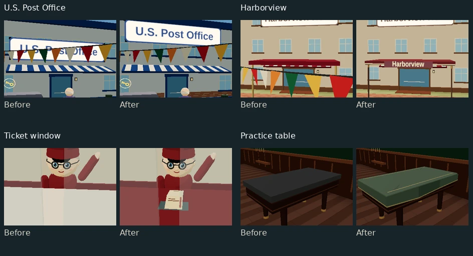

# Maple Harbor graphics review

I reviewed 43 views at 390 × 844 and 1280 × 800, from the full street approach down to the punched ticket and wallet clasp. Each row links the two original-resolution frames for each device. The comparison starts at `origin/plans8/mh` (`c7e844b2`). I inspected the incoming `glow8/mh` tip (`84006ba0`), made the corrections on `glow8b/mh`, and photographed the result.

## Findings

The largest readability gains were at the Post Office and Harborview. Moving the postal sign above the pennants recovered the entire name. A backed hotel valance and a clear span between the banner poles recovered the lettering at taxi height. The first cloth revision still showed the dark corner of the spare pool table through a gap. The final skirt and hem meet at that corner.

The shore approach, vegetable stall, bales, hydrants and practice table finish at **7/10**. Each received another pass. Their silhouettes or large surfaces still lack the variation that makes the strongest props convincing. The trap stack and fish crates earn **9/10** because their construction reads even when stacked.

**Phone draw calls met the budget in all 43 views.** 40 matched the baseline and 3 used fewer calls. The largest measured increase in submitted triangles was 9,493 in the pier view. The figures are per rendered frame in headless Chromium. [Camera coordinates and frame counters](glow8b/frames.csv)

## Capture conditions

- Both revisions used production Vite builds, Chromium 156 with ANGLE/SwiftShader, the low graphics setting, device scale factor 1 and identical camera placement within each device pair. The phone context enabled touch. The linked frame pairs use lossless WebP at the captured dimensions.
- Street and room inspections show the game canvas with the observer hidden. The fixed inspection lens spans 48° on the shorter axis. The simulation used a seeded random source and a fixed clock. The wallet and guitar came from their live street encounters. The return view uses the sea-mode scene from a boat offshore.
- The taxi arrival and Go Fish frames retain the HUD and use their gameplay cameras. Go Fish uses deal seed 124 and the first playable hand. The fixed-camera images alongside these show pavement and textile details that the overlay can cover.
- The B12 commit refers to `.b8/GLOW-PLAN-2.md`. Neither comparison tip tracks that file, so the commit history and round-specific geometry tests supplied the inventory. Tables include the market’s four counters separately and the gear aboard a working boat. The merged stone-ring and taxi-camera work appears in both comparison tips.
- Scores use the weaker of the two views. A 7 means the subject reads but a material or silhouette still looks simplified. An 8 means it reads clearly in context. A 9 means the construction remains convincing at both sizes.

## Landmarks, arrivals and interiors

| Place | Round | Rating before → after | Phone calls before → after | Art direction | 390 × 844 | 1280 × 800 |
|---|---|---:|---:|---|---|---|
| Harbor Square fountain | B1, B5 | 6 → **8** | 54 → 54 | The stepped lip separates stone from water. Four broken glints give the spray a landing point without turning the basin into a target. | [Before](glow8b/before/390x844/fountain.webp) · [After](glow8b/after/390x844/fountain.webp) | [Before](glow8b/before/1280x800/fountain.webp) · [After](glow8b/after/1280x800/fountain.webp) |
| Taxi boarding curb | B1 | 6 → **8** | 55 → 55 | The swept brick bay and yellow inset locate the stop alongside the cab. Both turn-in ends stay within the pavement. | [Before](glow8b/before/390x844/taxi.webp) · [After](glow8b/after/390x844/taxi.webp) | [Before](glow8b/before/1280x800/taxi.webp) · [After](glow8b/after/1280x800/taxi.webp) |
| Taxi stand from the arrival camera | B1 | 7 → **8** | 50 → 50 | The cab, boarding mark and Vinnie occupy the same part of the street. The taller phone shot keeps the player below the cab. | [Before](glow8b/before/390x844/taxi-arrival.webp) · [After](glow8b/after/390x844/taxi-arrival.webp) | [Before](glow8b/before/1280x800/taxi-arrival.webp) · [After](glow8b/after/1280x800/taxi-arrival.webp) |
| Dan’s dining room | B1 | 5 → **8** | 15 → 15 | Flax and narrow blue edges separate the white plates from the maple table. The wood remains visible along the near edge. | [Before](glow8b/before/390x844/dining.webp) · [After](glow8b/after/390x844/dining.webp) | [Before](glow8b/before/1280x800/dining.webp) · [After](glow8b/after/1280x800/dining.webp) |
| Go Fish with Dan and Nora | B1 | 6 → **8** | 13 → 13 | The hosts’ faces, playing surface and learner’s controls form three readable levels. The navy-backed cards stand out against the flax cloth. | [Before](glow8b/before/390x844/gofish.webp) · [After](glow8b/after/390x844/gofish.webp) | [Before](glow8b/before/1280x800/gofish.webp) · [After](glow8b/after/1280x800/gofish.webp) |
| Harborview Hotel entrance | B3, B5 | 6 → **8** | 43 → 42 | The street-facing name needed a deeper, solid-backed valance. Removing the crossing pennants leaves both the door and its name visible from the road. | [Before](glow8b/before/390x844/hotel.webp) · [After](glow8b/after/390x844/hotel.webp) | [Before](glow8b/before/1280x800/hotel.webp) · [After](glow8b/after/1280x800/hotel.webp) |
| Walter’s ticket window | B3 | 5 → **8** | 11 → 11 | The red sill and steel tray frame the handoff. Two printed rules and a red band distinguish the near leaf from blank paper. | [Before](glow8b/before/390x844/tickets.webp) · [After](glow8b/after/390x844/tickets.webp) | [Before](glow8b/before/1280x800/tickets.webp) · [After](glow8b/after/1280x800/tickets.webp) |
| Sunny Cup counter | B3, B5 | 7 → **8** | 13 → 13 | Mia’s hair clears the menu rail. The cream heading leads the eye, with prices quieter than drink names. The smallest menu copy still requires approaching the counter. | [Before](glow8b/before/390x844/sunny-cup.webp) · [After](glow8b/after/390x844/sunny-cup.webp) | [Before](glow8b/before/1280x800/sunny-cup.webp) · [After](glow8b/after/1280x800/sunny-cup.webp) |
| Return to Maple Harbor by sea | B3, B5 | 4 → **7** | 6 → 6 | The wharf, nearer shed and shaded door give the shore a point of arrival. The more distant houses still read as flat blocks on the phone. | [Before](glow8b/before/390x844/return-shore.webp) · [After](glow8b/after/390x844/return-shore.webp) | [Before](glow8b/before/1280x800/return-shore.webp) · [After](glow8b/after/1280x800/return-shore.webp) |
| Curbside maple trees | B5 | 6 → **8** | 36 → 36 | The split trunk connects the uneven crowns. The silhouette reads from the intersection without relying on individual leaves. | [Before](glow8b/before/390x844/maples.webp) · [After](glow8b/after/390x844/maples.webp) | [Before](glow8b/before/1280x800/maples.webp) · [After](glow8b/after/1280x800/maples.webp) |
| Stone ring and stair approach | Merge | 8 → **8** | 24 → 24 | The round stones frame the stair without covering its first tread. Both comparison tips already contain this repair. | [Before](glow8b/before/390x844/stone-ring.webp) · [After](glow8b/after/390x844/stone-ring.webp) | [Before](glow8b/before/1280x800/stone-ring.webp) · [After](glow8b/after/1280x800/stone-ring.webp) |

## Market, waterfront and square

| Place | Round | Rating before → after | Phone calls before → after | Art direction | 390 × 844 | 1280 × 800 |
|---|---|---:|---:|---|---|---|
| Market fruit counter | B6 | 5 → **8** | 34 → 34 | The painted timber apron gives the counter weight. Small green leaves pick out individual fruit against the warm awning. | [Before](glow8b/before/390x844/market.webp) · [After](glow8b/after/390x844/market.webp) | [Before](glow8b/before/1280x800/market.webp) · [After](glow8b/after/1280x800/market.webp) |
| Market flower counter | B6 | 4 → **8** | 41 → 41 | Notched petals break up the two rows. The flowers now have a silhouette distinct from fruit on the neighboring counter. | [Before](glow8b/before/390x844/flower-market.webp) · [After](glow8b/after/390x844/flower-market.webp) | [Before](glow8b/before/1280x800/flower-market.webp) · [After](glow8b/after/1280x800/flower-market.webp) |
| Market vegetable counter | B6 | 5 → **7** | 36 → 36 | Lower, elongated forms and alternating angles distinguish the vegetables. The goods remain evenly spaced in two rows. | [Before](glow8b/before/390x844/vegetable-market.webp) · [After](glow8b/after/390x844/vegetable-market.webp) | [Before](glow8b/before/1280x800/vegetable-market.webp) · [After](glow8b/after/1280x800/vegetable-market.webp) |
| Market bakery counter | B6 | 4 → **8** | 39 → 39 | Flattened, toasted loaves and pale scoring make the bakery legible without reading the overhead sign. | [Before](glow8b/before/390x844/bakery-market.webp) · [After](glow8b/after/390x844/bakery-market.webp) | [Before](glow8b/before/1280x800/bakery-market.webp) · [After](glow8b/after/1280x800/bakery-market.webp) |
| Trattoria place settings | B6 | 5 → **8** | 16 → 16 | Plate rims and folded napkins flank the wine-red runner. The candle remains visible between the two settings. | [Before](glow8b/before/390x844/trattoria.webp) · [After](glow8b/after/390x844/trattoria.webp) | [Before](glow8b/before/1280x800/trattoria.webp) · [After](glow8b/after/1280x800/trattoria.webp) |
| Pier Restaurant, seaward facade | B6 | 4 → **8** | 119 → 119 | The dark siding anchors the windows. The fascia and timber dock edge span the building without erasing the piles below. | [Before](glow8b/before/390x844/pier.webp) · [After](glow8b/after/390x844/pier.webp) | [Before](glow8b/before/1280x800/pier.webp) · [After](glow8b/after/1280x800/pier.webp) |
| Lobster truck serving hatch | B6 | 5 → **8** | 59 → 59 | The cream reveal frames the dark interior. Tapered bottle tops and the contrasting counter edge give the opening a human scale. | [Before](glow8b/before/390x844/hatch.webp) · [After](glow8b/after/390x844/hatch.webp) | [Before](glow8b/before/1280x800/hatch.webp) · [After](glow8b/after/1280x800/hatch.webp) |
| Fountain benches | B7 | 5 → **8** | 58 → 58 | Three timber slats and iron arms separate seat, back and supports against the pale paving. | [Before](glow8b/before/390x844/plaza-bench.webp) · [After](glow8b/after/390x844/plaza-bench.webp) | [Before](glow8b/before/1280x800/plaza-bench.webp) · [After](glow8b/after/1280x800/plaza-bench.webp) |
| Harbor Bank entrance | B7 | 6 → **8** | 61 → 61 | The broad column feet meet the stone base and the capitals frame the sign. Blue glass keeps the entry distinct from the wall. | [Before](glow8b/before/390x844/bank.webp) · [After](glow8b/after/390x844/bank.webp) | [Before](glow8b/before/1280x800/bank.webp) · [After](glow8b/after/1280x800/bank.webp) |
| Corner Pocket doorway | B7 | 5 → **8** | 65 → 65 | The oak lower panel and divided glazing read as a door. The brass threshold stops short of the welcome mat. | [Before](glow8b/before/390x844/pocket.webp) · [After](glow8b/after/390x844/pocket.webp) | [Before](glow8b/before/1280x800/pocket.webp) · [After](glow8b/after/1280x800/pocket.webp) |
| Square flower planters | B7 | 4 → **8** | 39 → 39 | The muted flowers sit in green foliage above a framed cedar box. Individual petal edges read best on the nearer heads. | [Before](glow8b/before/390x844/planter.webp) · [After](glow8b/after/390x844/planter.webp) | [Before](glow8b/before/1280x800/planter.webp) · [After](glow8b/after/1280x800/planter.webp) |

## Street furniture, rooms and vehicles

| Place | Round | Rating before → after | Phone calls before → after | Art direction | 390 × 844 | 1280 × 800 |
|---|---|---:|---:|---|---|---|
| Street litter bins | B8 | 4 → **8** | 46 → 46 | The wider mouth reads as an opening from above. The narrow rim and vertical ribs keep the body from looking like a solid post. | [Before](glow8b/before/390x844/bin.webp) · [After](glow8b/after/390x844/bin.webp) | [Before](glow8b/before/1280x800/bin.webp) · [After](glow8b/after/1280x800/bin.webp) |
| U.S. Post Office | B8 | 5 → **9** | 63 → 63 | The raised name clears the pennants from the square. The brick courses and pale cap give the lower facade an edge without competing with the sign. | [Before](glow8b/before/390x844/post.webp) · [After](glow8b/after/390x844/post.webp) | [Before](glow8b/before/1280x800/post.webp) · [After](glow8b/after/1280x800/post.webp) |
| Corner Pocket practice table | B8 | 4 → **7** | 78 → 78 | An uneven bound hem and diagonal corner creases soften the cover. The large dark top still reads as a single plane at room distance. | [Before](glow8b/before/390x844/practice.webp) · [After](glow8b/after/390x844/practice.webp) | [Before](glow8b/before/1280x800/practice.webp) · [After](glow8b/after/1280x800/practice.webp) |
| Dan’s living-room sofa | B8 | 4 → **8** | 11 → 11 | The seats and back cushions separate clearly. The throw now falls over the front of the arm, where its woven bands show from the room. | [Before](glow8b/before/390x844/sofa.webp) · [After](glow8b/after/390x844/sofa.webp) | [Before](glow8b/before/1280x800/sofa.webp) · [After](glow8b/after/1280x800/sofa.webp) |
| Convertible cockpit | B9 | 6 → **8** | 34 → 34 | The seat pads, dash and wheel separate the driver from the cream interior. The center console reads between the front seats. | [Before](glow8b/before/390x844/convertible.webp) · [After](glow8b/after/390x844/convertible.webp) | [Before](glow8b/before/1280x800/convertible.webp) · [After](glow8b/after/1280x800/convertible.webp) |
| Pier motorboat interior | B9 | 6 → **8** | 35 → 35 | The deck boards, cockpit rim and seating follow the hull. The fittings stay inside the gunwale in the overhead view. | [Before](glow8b/before/390x844/motorboat.webp) · [After](glow8b/after/390x844/motorboat.webp) | [Before](glow8b/before/1280x800/motorboat.webp) · [After](glow8b/after/1280x800/motorboat.webp) |
| Police station entrance | B9 | 6 → **8** | 50 → 50 | The blue-grey frame and kick plate define the threshold. The officer and the striped awning leave the entry identifiable. | [Before](glow8b/before/390x844/police.webp) · [After](glow8b/after/390x844/police.webp) | [Before](glow8b/before/1280x800/police.webp) · [After](glow8b/after/1280x800/police.webp) |
| Rental model-car display | B9 | 5 → **8** | 45 → 45 | The model presents its side against a coastal-road print. The turntable and key board give the two sides of the case different roles. | [Before](glow8b/before/390x844/rental.webp) · [After](glow8b/after/390x844/rental.webp) | [Before](glow8b/before/1280x800/rental.webp) · [After](glow8b/after/1280x800/rental.webp) |
| Harvest bale stack | B10 | 5 → **7** | 30 → 30 | Staggered straw marks break the ruler-straight grain. The straps hold the stack together, though the corners remain very square. | [Before](glow8b/before/390x844/bales.webp) · [After](glow8b/after/390x844/bales.webp) | [Before](glow8b/before/1280x800/bales.webp) · [After](glow8b/after/1280x800/bales.webp) |
| Lobster truck standing tables | B10 | 5 → **8** | 52 → 52 | The timber inset, metal collar and bottle nozzles read at the closer table. The rims hold a consistent width around the tops. | [Before](glow8b/before/390x844/standing-table.webp) · [After](glow8b/after/390x844/standing-table.webp) | [Before](glow8b/before/1280x800/standing-table.webp) · [After](glow8b/after/1280x800/standing-table.webp) |
| Curbside barrel planters | B10 | 4 → **8** | 47 → 47 | Staves and hoops carry the barrel’s taper. Low petal clusters sit against the foliage and leave the upper hoop visible. | [Before](glow8b/before/390x844/barrel.webp) · [After](glow8b/after/390x844/barrel.webp) | [Before](glow8b/before/1280x800/barrel.webp) · [After](glow8b/after/1280x800/barrel.webp) |
| Main Street fire hydrants | B10 | 4 → **7** | 71 → 71 | Wider, tapered hose bosses read from the curb and the brass nut catches the light. The underlying body still has a plain cylindrical profile. | [Before](glow8b/before/390x844/hydrant.webp) · [After](glow8b/after/390x844/hydrant.webp) | [Before](glow8b/before/1280x800/hydrant.webp) · [After](glow8b/after/1280x800/hydrant.webp) |

## Encounters, storefronts and harbor gear

| Place | Round | Rating before → after | Phone calls before → after | Art direction | 390 × 844 | 1280 × 800 |
|---|---|---:|---:|---|---|---|
| Street musician’s guitar | B11 | 5 → **8** | 53 → 53 | The neck now crosses the musician’s body toward the other hand. The dark sound hole and bridge carry the shape at phone size. | [Before](glow8b/before/390x844/guitar.webp) · [After](glow8b/after/390x844/guitar.webp) | [Before](glow8b/before/1280x800/guitar.webp) · [After](glow8b/after/1280x800/guitar.webp) |
| Dropped wallet encounter | B11 | 4 → **8** | 58 → 58 | The thinner profile meets the pavement. The contrasting tab, snap and stitching distinguish folded leather from a small parcel. | [Before](glow8b/before/390x844/wallet.webp) · [After](glow8b/after/390x844/wallet.webp) | [Before](glow8b/before/1280x800/wallet.webp) · [After](glow8b/after/1280x800/wallet.webp) |
| Threads mannequin display | B11 | 5 → **8** | 69 → 69 | Muted backing panels separate the pale heads from the case. The joined necklines and fabric details read through the glass. | [Before](glow8b/before/390x844/threads.webp) · [After](glow8b/after/390x844/threads.webp) | [Before](glow8b/before/1280x800/threads.webp) · [After](glow8b/after/1280x800/threads.webp) |
| Snip & Style frontage | B11 | 5 → **8** | 67 → 67 | The paneled bay balances the blue window. The stripe, shop name and entrance hold together as a single storefront. | [Before](glow8b/before/390x844/salon.webp) · [After](glow8b/after/390x844/salon.webp) | [Before](glow8b/before/1280x800/salon.webp) · [After](glow8b/after/1280x800/salon.webp) |
| Occupied street bench | B12 | 5 → **8** | 51 → 51 | The slats remain visible around the seated reader. The dark feet ground the bench and the paper clears the backrest. | [Before](glow8b/before/390x844/street-bench.webp) · [After](glow8b/after/390x844/street-bench.webp) | [Before](glow8b/before/1280x800/street-bench.webp) · [After](glow8b/after/1280x800/street-bench.webp) |
| Beach chairs | B12 | 5 → **8** | 83 → 83 | Separate back slats and seat stripes show the incline, especially on the red chair. The cream chair stays distinct against the sand. | [Before](glow8b/before/390x844/beach-chairs.webp) · [After](glow8b/after/390x844/beach-chairs.webp) | [Before](glow8b/before/1280x800/beach-chairs.webp) · [After](glow8b/after/1280x800/beach-chairs.webp) |
| Shore lobster-trap stack | B12 | 4 → **9** | 34 → 33 | The inset grids read as wire and the runners as timber. Both layers remain visible through the stepped stack. | [Before](glow8b/before/390x844/traps.webp) · [After](glow8b/after/390x844/traps.webp) | [Before](glow8b/before/1280x800/traps.webp) · [After](glow8b/after/1280x800/traps.webp) |
| Pier fish crates | B12 | 4 → **9** | 35 → 35 | Dark handle openings and colored rails make each crate readable. The stacked red and blue rims stay distinct at phone size. | [Before](glow8b/before/390x844/crates.webp) · [After](glow8b/after/390x844/crates.webp) | [Before](glow8b/before/1280x800/crates.webp) · [After](glow8b/after/1280x800/crates.webp) |
| Working boat’s trap and crate cargo | B12 | 4 → **8** | 29 → 28 | The same wire and handle details survive on deck. The muted framework separates the cargo from the boat’s stronger red trim. | [Before](glow8b/before/390x844/boat-cargo.webp) · [After](glow8b/after/390x844/boat-cargo.webp) | [Before](glow8b/before/1280x800/boat-cargo.webp) · [After](glow8b/after/1280x800/boat-cargo.webp) |

## Verification

Both revisions passed `npm run build`. The final branch also passed `npm run typecheck` and `npm test -- --maxWorkers=2 --testTimeout=60000` (131 files, 1,746 tests). Focused checks include letter height and clearance at the hotel fascia, the width of the bin opening, the slim wallet profile and the closed practice-table corner.
