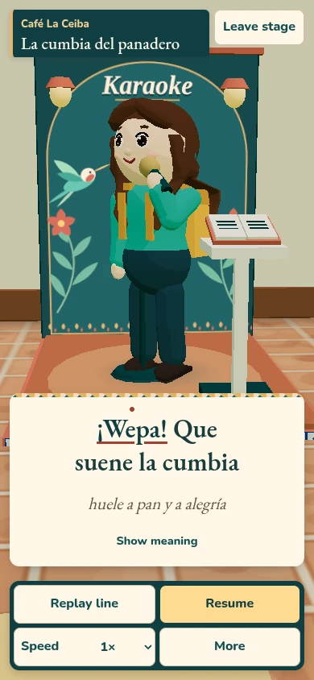
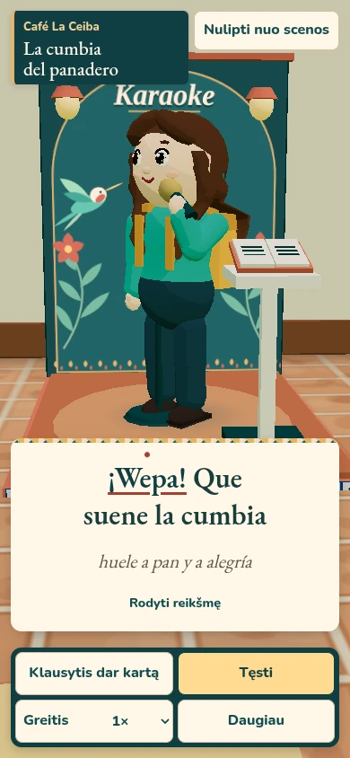
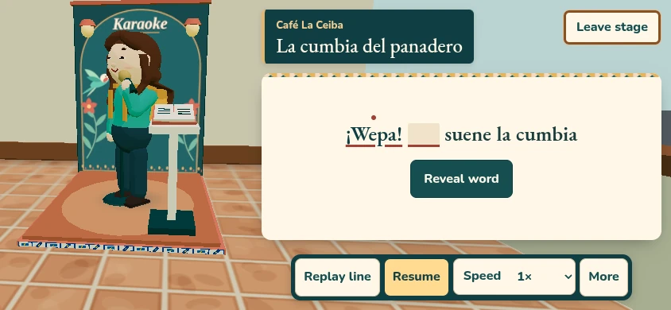
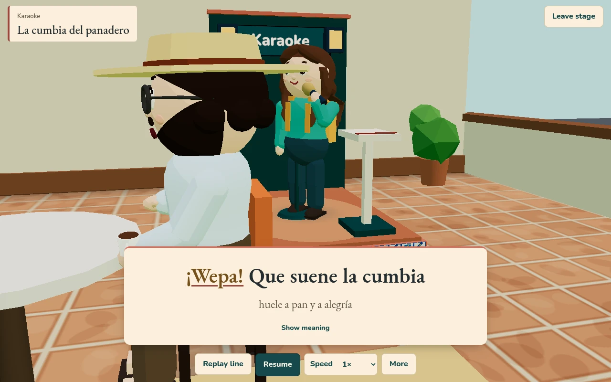
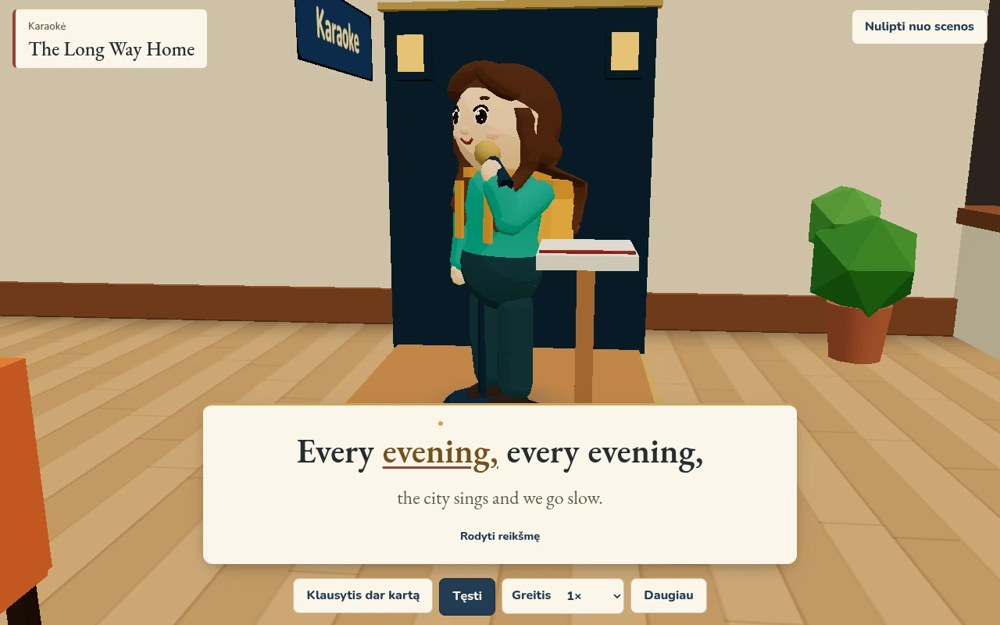
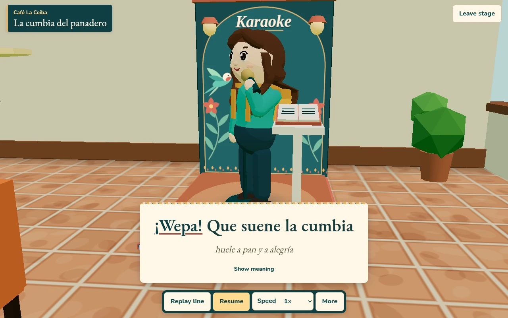

# Karaoke at Café La Ceiba

La Ceiba’s strongest view is the tall phone. The singer, hand mic and painted colibrí are visible together, with room below for the current line and its preview. Turning the phone puts the singer in the left pane and gives the song its own reading area on the right.

## Viewport ratings

These are my visual and interaction ratings from the two Puerto Colibrí builds. The brief supplied the art director’s approximately 9/10 rating for Maple Harbor.

| Viewport and settings | Rating | What drove the score | English UI | Lithuanian UI |
| --- | ---: | --- | --- | --- |
| 390 × 844 · touch, default text | 9/10 | Two full jackets fit across the stand. The bird, mic and face read clearly above the lyric card. Replay and Continue stay under the same thumb between turns. | [Current line](karaoke-pc/390x844-en.webp) | [Current line](karaoke-pc/390x844-lt.webp) |
| 390 × 664 · touch, 130% text | 8.5/10 | The singer’s face and mic survive the larger controls. The first long English gloss needs more space than its Lithuanian counterpart. The meanings scroll within the card while the close control stays reachable. | [Meaning](karaoke-pc/390x664-en.webp) | [Meaning](karaoke-pc/390x664-lt.webp) |
| 844 × 390 · touch, default text | 9/10 | The title and transport sit beside the singer. The whole word challenge fits, and revealing the answer keeps its place in the sentence. The shallow room view shows less of the café audience. | [Missing word](karaoke-pc/844x390-en.webp) | [Missing word](karaoke-pc/844x390-lt.webp) |
| 1280 × 800 · mouse, reduced motion | 9/10 | The open songbook reads from across the aisle, the foreground guest clears the singer, and the lyric card sits below the mic. The plain café wall on either side keeps the set visually modest. | [Current line](karaoke-pc/1280x800-en.webp) | [Current line](karaoke-pc/1280x800-lt.webp) |

### The same stage in both learner layers

| English UI · 390 × 844 | Lithuanian UI · 390 × 844 |
| --- | --- |
|  |  |

## Comparison with Maple Harbor

I built the fetched Maple Harbor reference at `32076c6e` and the original Puerto Colibrí port at `46353503`. I compared their doorway, picker, song detail and first sung line at all four sizes. In the original wide PC shot a guest’s hat crossed the singer. Maple Harbor’s position in the aisle cleared the face. I also played G01 through Echo, a word reveal, slowdown, applause and the walk back to the counter in the reference build. La Ceiba now uses that wide shot and centres the performer in the left side of the landscape layout.

| Original Puerto Colibrí | Maple Harbor reference | Revised Puerto Colibrí |
| --- | --- | --- |
|  |  |  |

The portrait camera keeps the approach to the stand familiar. The teal arch, coral flowers, clay sconces and open songbook give the café its own backdrop. A narrow ceramic pattern on the song stand and lyric sheet echoes the tiled riser. The artwork uses a single painted sign texture and the existing static prop and lamp draws.

## Playthrough evidence

| Action | Capture |
| --- | --- |
| Walk in from the street and pick a song | [La Ceiba from the door](karaoke-pc/sme-cafe.webp) · [Tall-phone cover shelf](karaoke-pc/sme-picker.webp) · [Song details at large type](karaoke-pc/sm-sg01-details.webp) |
| Browse a bilingual song without a course jacket | [SB01 paper sleeve](karaoke-pc/sme-sb01-sleeve.webp) |
| Take an Echo turn and replay the call | [SB01 with English UI](karaoke-pc/sme-echo-turn.webp) · [SG01 with Lithuanian UI](karaoke-pc/sm-echo-turn.webp) |
| Fill the blank, reveal the word and slow the track | [Revealed answer](karaoke-pc/sme-word-revealed.webp) · [Lithuanian 0,8× control](karaoke-pc/sm-slow.webp) |
| Finish, leave the stage and walk to the counter | [Reduced-motion finish](karaoke-pc/sme-finish.webp) · [At the counter after walking](karaoke-pc/sm-walk.webp) |

## Verification

The browser runs used headless Chromium 156 with software WebGL, at one device pixel per CSS pixel. The game’s walking controller took the learner through the café door, to the stand and back to the barista. Touch or mouse input operated the visible booth controls. The final interaction opened the ordinary café conversation.

Both local origins served their course’s own index, sampled song jackets and complete timed lyrics. The English layer listed 186 songs and exercised SB01’s English call before its Spanish target. The Lithuanian layer listed 130. Each loaded its own SV64 take. The tests used local, duration-matched silent WAVs, checked the media clock at 0.8× and sought to the last call for the finish. The private-mic checks used an on-device recognizer fixture. Listening quality and physical-phone audio were outside this Chromium review.

Both production builds passed `tsc --noEmit` and the localization audit passed. For the local review, both builds used `VITE_RADIO_INDEX=/songs/index.json`, `VITE_RADIO_FILES=/karaoke-files` and `VITE_RADIO_RECORDINGS=https://audio.dvikalbesdainos.lt/spanish-master`. The files and recordings settings let the test server intercept the course’s indexed recording URLs.

The base branch’s two town-atlas checks produced different canvas-command hashes on Linux x64. I verified both hashes with the original painters from before `567ffbee`. The test now accepts those exact streams alongside the existing digests. The atlas dimensions, draw counts, UV hashes and text checks still run.

[Browser playthrough](../../tests/browser/karaoke.mjs) · [Learner-facing copy](WORDS-karaoke-pc.md) · [Karaoke plan on the reference branch](https://github.com/tomaslibas21-bit/english-world/blob/32076c6e/docs/KARAOKE-PLAN.md)
