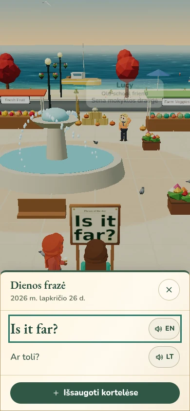
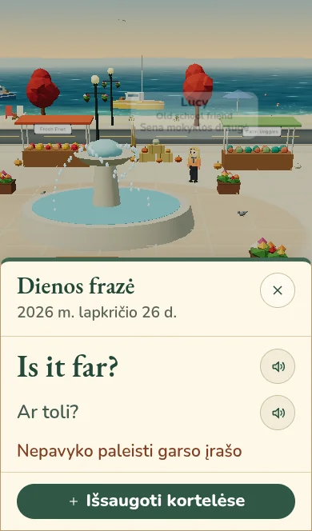
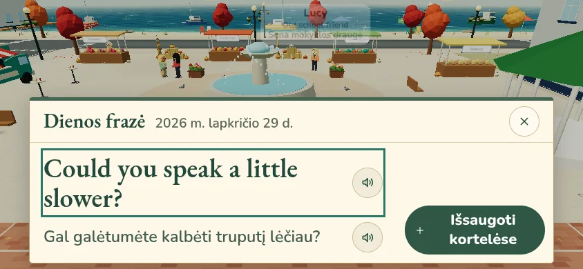
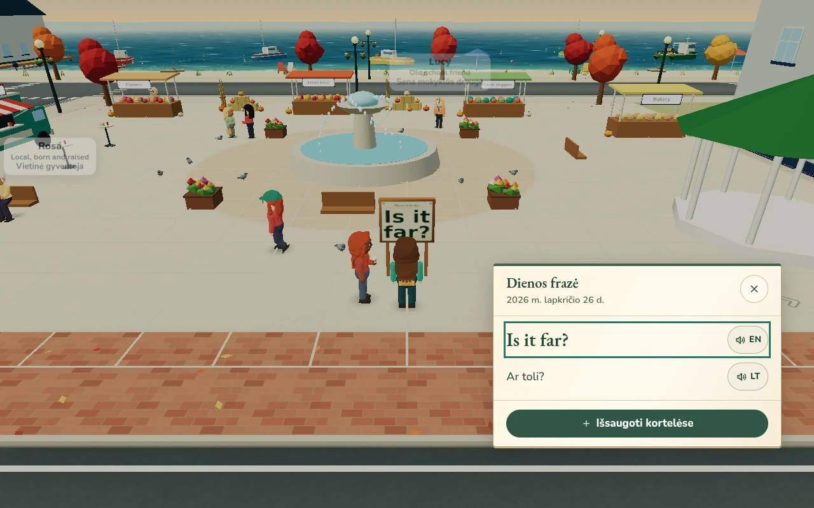

# Maple Harbor phrase-of-the-day noticeboard

From Main Street, enter the farmers’ market at the square drop-off. The maple board is just to the right, at (32, −18.9), facing south. Its reading mark is (32, −17.3). On November 26, 2026 the sheet reads **Is it far? / Ar toli?**

The English face and Lithuanian reading sheet use the same local-date posting. Approaching the square loads the existing 200-row Maple Harbor deck once. The board rotates through the 14 agreed IDs, refreshes on return or local midnight, and holds an open sheet steady between Hear and Save. Each sentence is a labeled speaker button. Reading and saving are silent. Save uses the existing Cards store and course mirror configuration. A card from an earlier encounter keeps its source and review schedule.

## Implementation

| Files | Purpose |
| --- | --- |
| `src/game/noticeboard/posting.ts`, `prop.ts` | Daily rotation, lazy deck, date lifetime, static mesh and painted atlas |
| `src/game/world/town.ts`, `src/game/Game.ts`, `src/game/gameRef.ts` | Town collider, reading mark, nearest interaction, panel lifecycle and cleanup |
| `src/state/cards.ts`, `src/ui/kit/PhraseSave.tsx` | Report whether a new card could be saved in this browser or only held for this visit |
| `src/state/store.ts`, `src/ui/Hud.tsx`, `src/ui/Panels.tsx` | Read prompt, touch action, HUD visibility and panel routing |
| `src/ui/NoticeboardSheet.tsx`, `src/ui/noticeboard.css`, `src/ui/Cards.tsx` | Modal paper, named audio, localized controls, card membership and source display |
| `tests/noticeboard.test.ts`, `tests/phrase-primitives.test.ts`, `tests/browser/noticeboard.mjs` | Calendar and lifecycle regressions, browser input and audio ownership |
| [WORDS-noticeboard.md](WORDS-noticeboard.md), [review captures](noticeboard-review/) | Bilingual copy, all 14 references and both clip names per posting, runtime screenshots |

## Verification

- TypeScript passed with `npx tsc --noEmit`. The production Vite build passed with the radio and named-file audio base configured.
- The complete `npx vitest run` passed **1,696 tests across 123 files**.
- The related Vitest run passed 96 tests across eight files with `TZ=America/New_York`. It covered the anchor and wrap dates, both daylight-saving transitions, a pending load across midnight, focus, cached revisits, and a missing posting.
- Chromium walked from the drop-off to the mark and through both sides. Booting away from the square requested zero board decks or clips. First approach made one deck request. With the network offline, the English and Lithuanian stayed readable and the next posting opened from memory.
- Both day-one speaker controls requested their exact files. Forced 404s left Save usable. Two taps made one card with an empty situation ID, source `Dienos frazė · TOM-102#S027`, box 1 and a due date of local midnight. Deleting it in Cards restored the Save action on return. When browser storage refused a write, the card remained available in memory and the sheet announced its session-only lifetime.
- The production browser test checked Tab, Shift+Tab, Enter and return focus on the town prompt. It also used a simulated standard controller and silent audio fixtures. X opened the paper, the D-pad reached both speakers, Save and Close, A activated each selected action, and B returned to town. Replay switched the voice. The radio held during playback and resumed on exit. Starting a café conversation interrupted the board clip. Re-saving an already reviewed card preserved its exact stored fields.

### Rendering and requests

The desktop Chromium software renderer ran at low game quality. At the same reading pose, hiding just the board and rendering the frame again measured its incremental cost.

| 390 × 664, A++, reduced motion | Scene draws, hidden → visible | Scene triangles, hidden → visible | Resident geometries / textures |
| --- | --- | --- | --- |
| Before first opening | 41 → 42 | 190,155 → 190,191 | 45 / 14 |
| After ten exits | 42 → 43 | 190,195 → 190,231 | 45 / 14 |

The prop adds one draw and 36 triangles in both samples. Its single 256 × 256 atlas is reused. The source deck is 54,367 bytes and the uncompressed production deck chunk is 49,604 bytes. Ten silent visits used one deck request, zero named-file requests, and ended with the voice idle. The clock uses one timeout to the next local midnight near the board. Leaving the area, hiding the tab or pinning the sheet clears it.

### Runtime review frames

These are Maple Harbor EN/LT captures from Chromium 156 on Debian with touch emulation, low game quality, device pixel ratio 1 and reduced motion enabled. The dates and returning learner profile are fixtures. Each image opens at its captured CSS viewport size.

| 390 × 844 · A · first posting | 390 × 664 · A++ · failed translation audio |
| --- | --- |
|  |  |
| **844 × 390 · A++ · longer posting** | **1280 × 800 · A · paper beside the square board** |
|  |  |

[Main Street approach, 1280 × 800 · A](noticeboard-review/approach.webp) · [Saved check, 390 × 664 · A++](noticeboard-review/saved.webp) · [Resulting card, 390 × 664 · A++](noticeboard-review/card.webp)

## Open review

The human editor and owner still need to approve the fortnight and its placement. The checkout has no resident phrase recordings. Listen to all 28 target/helper files on the authorized English Master origin before accepting voice quality. Physical-phone p95 frame timing and hands-on controller and screen-reader review remain open.
